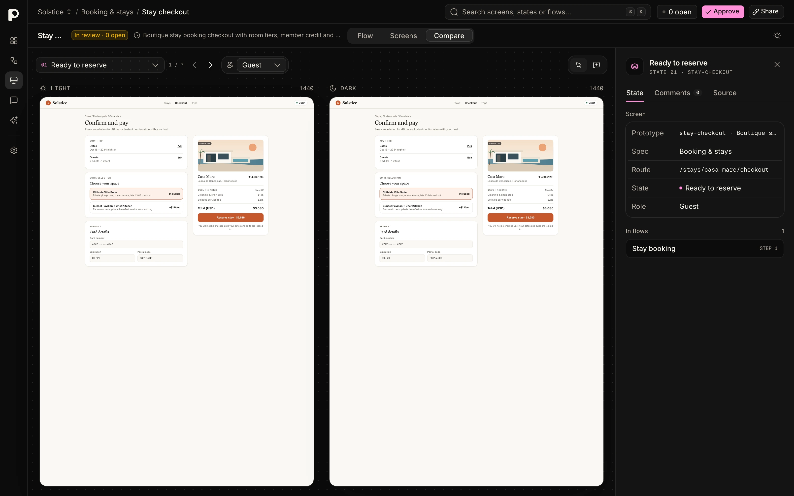
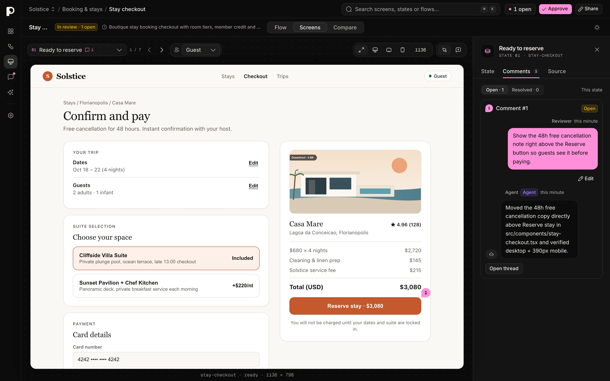
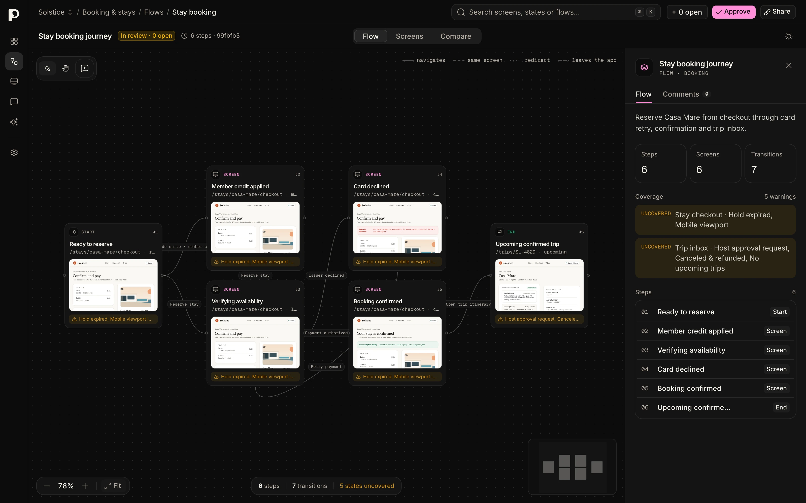

<p align="center">
  
</p>

<p align="center">
  <strong>Prototype with your real components. Review with people and agents.</strong>
</p>

<p align="center">
  <a href="https://www.npmjs.com/package/@protohq/cli"></a>
  
  <a href="https://github.com/proto-hq/proto/blob/main/LICENSE"></a>
</p>

---

`@protohq/cli` is a prototype gallery and review loop for React + Vite apps. You write
`*.proto.tsx` files beside your views, using the components you ship. `proto dev` opens a review
shell where people pin comments to elements, regions or flow steps. Each comment records the JSX
source chain of what was clicked, so a coding agent can open the exact line, fix it and answer
through the CLI or MCP. Agents never approve; people do.

<!-- screenshots (absolute URLs: npm does not resolve repository paths) -->
<p align="center">
  
</p>
<p align="center">
  
</p>
<p align="center">
  
</p>
<!-- /screenshots -->

> [!WARNING]
> **Experimental (0.x).** The public surface described here is the 0.x contract and may change
> between minor versions until 1.0. See [Status](#status).

## Why

- **Prototypes become the shipped UI.** Prototypes compose your production views and design
  system, not throwaway HTML, so the reviewed state is the code that ships.
- **Comments point at source.** Every comment stores the selector, the element text, the rects
  and the `file:line:column` chain of the JSX that rendered it, plus the commit, state, theme,
  role and viewport.
- **Agents run the review loop.** List, read, reply, resolve, attach screenshots and capture
  evidence from the CLI (`--json`) or MCP. Everything except approval works without a browser.
- **Prototypes can't reach production.** Build guards fail the build when prototype code
  reaches your production bundle, or when a prototype reaches your data layer.

## Features

- **Gallery shell.** Overview, spec pages, screen view with states, viewports, themes and roles,
  flow canvas with live previews, comments inbox, drafts and search. Prebuilt and self-styled, so
  it never imports your design system.
- **Typed prototypes.** `definePrototype` meta (title, spec, surface, route, states, roles) is read
  statically, never executed. `proto check` reports broken literals with stable problem codes.
- **Flows.** `defineFlow` journeys across prototype states and external pages, with coverage
  warnings for states no flow reaches.
- **Anchored comments.** Pick an element, drag a region or move a crosshair with the keyboard.
  Pins follow their anchor as the layout changes. Threads support replies, image attachments,
  resolve and reopen. Each prototype or flow has its own review status (in review or approved).
- **Isolated rendering.** Prototypes render in iframes on a separate origin, compiled by your own
  Vite config. They talk to the shell only through a typed, validated `postMessage` protocol.
- **Evidence.** `proto screenshot` (PNG via Playwright Chromium) and `proto evidence` (static HTML
  without scripts) under `docs/design/<slug>/`.
- **Static build.** `proto build` writes a read-only gallery to `dist-proto/` that works on any
  static host, at `/` or under a subpath.
- **Hosted review.** Cloud client commands target Proto Cloud; the review backend is private.

- **Migration.** `proto migrate` rewrites existing v1/v2 review files to the current format
  losslessly, with a verification report.

## Quick start

Requires a React 19 + Vite 8 app. Proto uses the app's Vite installation; install React and Vite
in the consumer before adding Proto.

```sh
bun add -d @protohq/cli
bunx proto login             # Google, GitHub or email; free account
bunx proto init --skills
bunx proto dev --open
```

`init` writes the config, canvas, welcome draft and Vite plugin integration; `--skills` also
installs the [agent skills](#the-review-loop). `proto --help` lists the commands; `proto --version`
prints the installed package version.

Install these optional peers only for the features you use:

| Feature                  | Optional peer                           | Setup                                                           |
| ------------------------ | --------------------------------------- | --------------------------------------------------------------- |
| Screenshots and evidence | `playwright` (`^1.64.0`)                | `bun add -d playwright` then `bunx playwright install chromium` |
| MCP server (`proto mcp`) | `@modelcontextprotocol/sdk` (`^1.32.2`) | `bun add -d @modelcontextprotocol/sdk`                          |

The gallery, local reviews and static builds do not require these optional integrations.

## One address for every project

Run `proto dev` in each app's terminal. Proto starts in the background when needed and serves
all project galleries at one address:

```console
$ cd ~/Dev/acme/apps/web
$ proto dev
Started Proto in the background. Stop it with: proto stop
Proto    http://127.0.0.1:4400/p/acme-web/
Home     http://127.0.0.1:4400/
```

A second app gets its own `/p/<label>/` URL at the same address. The home page at
`http://127.0.0.1:4400/` groups known projects by state: running, starting and stopped. Open a
project from there, the first breadcrumb's project menu, or the search palette's Projects group.
Folders under your home are shown with `~`. Tabs with the same title include the project label
(`Title · label`); the home tab is `Projects · Proto`. Unsent comment drafts belong to their
project; drafts saved before project isolation are left in the browser and are not migrated.

- Ctrl-C stops only the project in that terminal. Other projects and Proto keep running.
- `proto start` starts Proto in the background and returns; repeating it is harmless.
- `proto stop` stops Proto and returns. Project terminals stay alive, waiting for `proto start`,
  then reconnect. Their previews remain available while Proto is stopped.
- `proto status` lists the address, versions, project states, folders and URLs without starting
  anything. It can show `waiting` while Proto is stopped.
- After an unexpected stop, running projects try to restart Proto on the same port. The canvas
  shows a connection overlay while disconnected; it reloads only if the project instance changed.

`PROTOHQ_PORT` chooses Proto's port (default `4400`) when it starts. The last port is remembered
for later starts and URL commands. To move it, run `proto stop`, then
`PROTOHQ_PORT=4500 proto start`. Setting the variable while Proto is already running takes effect
after the next stop. `PROTOHQ_POLL=1` enables the project's polling file watcher.

Get a gallery URL with `proto url login-form --state error`. Get the separate preview address
with `proto url login-form --state error --bare`; start the project once before requesting its
first preview address. Preview and story origins are reserved per project, so do not construct
addresses from a gallery port. The app's own Vite config compiles prototypes and handles HMR.
Localhost redirects to `127.0.0.1`; `dev.allowedHosts` accepts extra hostnames for that project's
URLs only. The home and project list stay on the loopback address.

For agents, use `proto status --json`, `proto start --json`, `proto stop --json` and
`proto dev --json`. The first three return at once. `dev` writes one JSON line to stdout and
keeps serving the project; later lifecycle messages and warnings go to stderr:

```json
{
  "url": "http://127.0.0.1:4400/p/acme-web/",
  "home": "http://127.0.0.1:4400/",
  "label": "acme-web",
  "projectId": "9f2c41d07ab3e655",
  "state": "running",
  "renderOrigin": "http://127.0.0.1:24400"
}
```

A second `dev` for the same project exits 0 with `state: "already_running"`; `renderOrigin` may
be `null` while it starts. `start` returns `{ url, started, pid, version }`; `stop` returns
`{ stopped, waiting }`; `status` returns `{ daemon, projects }`, with `daemon: null` when Proto
is stopped and project rows carrying state, version and preview addresses. Lifecycle commands
are CLI-only; MCP still exposes `proto_review_status` for review state.

Captures (`proto screenshot`, `proto evidence`, `proto stories run`) reuse this project's running
server, including while Proto is stopped. Otherwise they serve it temporarily and close their
own resources without starting Proto in the background. Evidence HTML links to preview source
paths, without embedding a local origin.

If Proto does not start, inspect `~/.config/protohq/daemon/daemon.log`. `port_in_use` means the
address or preview ports are occupied; `daemon_unavailable` means Proto did not start or answer;
`daemon_version_mismatch` requires upgrading `@protohq/cli` in the project; `state_unavailable`
means its private state cannot be used. `project_busy` means a capture or startup still owns the
project; `project_offline` means the project stopped or has no preview address yet. Use
`proto status --json` to inspect before retrying. See the error registry for exact messages.

## Write a prototype

A component prototype lives beside the view it composes and renders it with fixture props:

```tsx
// src/components/login-form.proto.tsx
import { definePrototype, setParam, type PrototypeProps } from "@protohq/cli";
import { LoginForm } from "./login-form";

export const meta = definePrototype({
  title: "Sign in",
  spec: "auth",
  surface: "A1",
  route: "/login",
  standalone: true,
  states: [
    { id: "sign-in", label: "Sign in" },
    { id: "error", label: "Wrong password" },
  ],
});

export default function Prototype({ state }: PrototypeProps) {
  return (
    <LoginForm
      mode="sign-in"
      error={state === "error" ? "Invalid email or password" : null}
      pending={false}
      onModeChange={() => {}}
      onSubmit={() => setParam("state", "error")}
    />
  );
}
```

The gallery lists **Authentication → Sign in** with both states, without a reload.

- **Component prototypes** (`src/**/*.proto.tsx`) compose views. Unless they set `standalone`,
  they render inside your production chrome (`Frame`).
- **Drafts** (`src/drafts/<slug>/index.proto.tsx`) may use free markup for early exploration.
- `useSearch`, `setParam(s)` and `protoHref` keep prototype state in the URL, so every state has
  a shareable link and comments record the state the reviewer saw.

`proto.canvas.tsx` provides your app's providers and chrome:

```tsx
import type { CanvasProps, FrameProps } from "@protohq/cli";
import "./src/styles.css"; // your CSS loads on the render origin only
import { ThemeProvider } from "@acme/ui/theme";
import { AppShellView } from "./src/systems/shell/app-shell-view";

/** Providers around every rendered state. */
export function Canvas({ children, theme }: CanvasProps) {
  return <ThemeProvider theme={theme}>{children}</ThemeProvider>;
}

/** Production chrome around component prototypes (not drafts, not `standalone`). */
export function Frame({ route, children }: FrameProps) {
  return <AppShellView activeRoute={route}>{children}</AppShellView>;
}
```

## Flows

Flows chain prototype states (and external pages) into journeys:

```ts
// flows/sign-in.flow.ts
import { defineFlow } from "@protohq/cli/flow";

export const flow = defineFlow({
  title: "Sign in",
  spec: "auth",
  start: ["site"],
  nodes: {
    site: { external: "site", url: "/" },
    "sign-in": { proto: "login-form", state: "sign-in" },
    error: { proto: "login-form", state: "error" },
    home: { proto: "welcome", state: "default", end: true },
  },
  edges: [
    ["site", "sign-in", { on: "Sign in" }],
    ["sign-in", "error", { on: "Wrong password", kind: "overlay" }],
    ["error", "home", { on: "Signed in", kind: "redirect" }],
  ],
});
```

`proto flow show|list|coverage` print the steps; `proto check` reports unknown prototypes or states
and warns about states that no flow covers.

## The review loop

1. A reviewer opens the gallery, presses **C** and clicks an element (or drags a region), writes a
   comment and optionally attaches images.
2. An agent reads open comments with their source chain and attachments, fixes the code and
   replies or resolves:

   ```console
   $ proto comments list
   login-form-7  error  reviewer  4m  The error should sit under the password field…  src/components/login-form.tsx:58:27

   $ proto comments resolve login-form-7 --note "Fixed in src/components/login-form.tsx."
   ✓ login-form-7 resolved
   ```

3. The reviewer approves the prototype in the shell or with `proto review approve`. Approval
   records the commit and the number of comments still open. A new comment on an approved
   prototype puts it back in review. Locally, approval is trust-based (anyone with the repository
   can approve); on a remote gallery only an authorized human with an Editor seat can approve.

Every command has `--json` output with stable shapes and exit codes. `proto mcp` exposes the same
capabilities as MCP tools over stdio (`proto_comments_list`, `proto_comments_reply`,
`proto_comments_resolve`, `proto_screenshot`, …), and the results equal the CLI `--json`.
Approval, credentials, migration and process lifecycle are intentionally not MCP tools:
**agents never approve**.

`proto init --skills` installs two agent skills into `.agents/skills/` at the repository root (the
app root outside Git): `proto`, which covers how proto works, authoring, setup, the CLI and
troubleshooting, and `proto-apply-comments`, the review-comment loop. It also runs in an app that
is already set up, without touching its configuration. Run it again after upgrading: it replaces
stale copies (reported as `updated`) and lists copies of the 0.1.x `author-prototype` and
`apply-prototype-comments` skills for you to delete. Installed copies belong to the package, so
keep project-specific rules in your `AGENTS.md`.

Local review data lives in `proto/review/<key>.json` (one file per prototype or flow, committed with
your code), written under a per-key lock so the CLI, MCP and the dev server can write concurrently.

## Hosted review

Free still runs locally, including authoring, review and static builds. Interactive commands
(`proto dev`, `proto start`, `proto init` and `proto mcp`) need a free account: run `proto login`
and sign in with Google, GitHub or an email link in the browser. CI is exempt when `CI` is set
to a nonempty value other than `false` or `0` (case insensitive). `PROTOHQ_TOKEN` also supplies a
session. The CLI probes the active API origin with a three-second timeout. Only HTTP 401 or
explicit credential rejection in another 4xx response requires replacing credentials; all other
responses and transport failures keep local access. Headless local commands, including `check`, `build`, `stories run`, `migrate`,
`stop` and `status`, plus help, version output and the Vite/Storybook/Vitest integrations
(`proto()` and `protoPresentation()`), do not need login. Cloud commands keep their existing
account and plan requirements.

Pro adds hosted collaboration for **US$15/month per Editor seat**, or **US$12/month per Editor
seat billed yearly (US$144/year)**, plus any tax Stripe Tax adds at checkout. A Free workspace's
`proto share` answers `plan_required` with its upgrade URL.

```sh
proto login
proto whoami
proto workspace list
proto workspace use <slug>
proto share login-form
```

Publish a prototype, `proto share --flow <id>`, or `proto share --all`. Hosted snapshots at
`https://protohq.app` persist after the command exits. Invite reviewers with `--viewer`,
`--commenter` or `--approver`; use `proto share list`, `proto share invite <slug>` and
`proto share revoke <slug>` to manage shares. People approve in the browser; approvers need
an Editor seat. Publishing a new version reopens an approved share.

Add a version note with `--note "Ready for review"` (up to 280 characters). With Playwright,
publishing includes up to 60 state thumbnails. Use `--no-captures` to skip them.

Store commands require `--remote --share <slug>` and CLI login. Missing credentials report
`not_logged_in` (exit 4); missing `--share` reports `invalid_input` (exit 2); connection failures
report `network_unavailable` (exit 4). Local MCP store tools accept `remote: true` and `share`.
For hosted access without a checkout, connect an OAuth-capable Streamable HTTP MCP client to
`https://mcp.protohq.design/mcp` and authorize the workspace in the browser. Agents never approve.

The API is `https://api.protohq.design` and the web app `https://app.protohq.design`;
`PROTOHQ_API_URL=https://staging-api.protohq.design` targets staging. Self-hosted server exports and the former Cloudflare
sharing commands are removed; hosted review is operated by Proto.

## Documentation

- [CLI and setup](https://github.com/proto-hq/proto/blob/main/docs/cli.md)
- [Hosted sharing](https://github.com/proto-hq/proto/blob/main/docs/hosted-share.md)
- [MCP](https://github.com/proto-hq/proto/blob/main/docs/mcp.md)
- [Workspace collaboration](https://github.com/proto-hq/proto/blob/main/docs/workspace.md)
- [Security and trust](https://github.com/proto-hq/proto/blob/main/docs/security.md)
- [Troubleshooting](https://github.com/proto-hq/proto/blob/main/docs/troubleshooting.md)
- [Command catalog](https://github.com/proto-hq/proto/blob/main/docs/commands.md)
- [Error registry](https://github.com/proto-hq/proto/blob/main/docs/errors.md)

## Guards

`proto()` in your `vite.config.ts` and `protoPresentation()` in Storybook and Vitest enforce two
boundaries:

- **Production boundary.** `vite build` of your app fails if a `.proto.tsx`, a prototype fixture or
  gallery code reaches the production bundle.
- **Network guard.** A prototype, draft or story whose runtime imports reach a module listed in
  `guards.forbidRuntimeImports` (your API client, for example) fails Storybook, Vitest,
  `proto check` and `proto build`. Your application routes may import it.

```ts
// vite.config.ts
import { proto } from "@protohq/cli/vite";
export default defineConfig({ plugins: [react(), proto()] });

// vitest.config.ts / .storybook/main.ts (viteFinal)
import { protoPresentation } from "@protohq/cli/vite";
plugins: [react(), protoPresentation()];
```

## CLI

Every command accepts `--app <dir>` (default: cwd), `--json` and `--verbose`. Store-backed commands
accept `--remote`. Exit codes: `0` ok · `1` problems or user error · `2` usage · `3` missing
dependency · `4` remote or auth.

| Command                                                    | What it does                                                     |
| ---------------------------------------------------------- | ---------------------------------------------------------------- |
| `proto init [--skills]`                                    | Scaffold the app; `--skills` installs or updates agent skills    |
| `proto dev [--open]`                                       | Project gallery at the shared Proto address                      |
| `proto start`                                              | Start Proto in the background; idempotent                        |
| `proto stop`                                               | Stop Proto; project terminals wait and reconnect                 |
| `proto status`                                             | Inspect Proto and known projects without starting anything       |
| `proto build`                                              | Read-only `dist-proto/`; `--remote` builds for the review server |
| `proto list`                                               | Prototypes and flows                                             |
| `proto check`                                              | Problems and warnings, network guard, no-write render build      |
| `proto new <slug> [--draft] [--in <view>] [--spec <id>]`   | Scaffold a prototype or draft                                    |
| `proto flow new\|show\|list\|coverage`                     | Scaffold and inspect flows                                       |
| `proto url <slug> [--state <id>] [--bare]`                 | Gallery URL, or the bare render URL                              |
| `proto comments list\|show\|add\|reply\|resolve\|reopen`   | Read and answer threads (`--status`, `--waiting`, …)             |
| `proto comments attach\|detach\|edit\|attachments\|delete` | Images, edits, downloads; `delete` is reviewer-only              |
| `proto review status\|approve\|reopen`                     | Review status; approval is for people                            |
| `proto review unlock <key> --force`                        | Recover a review lock left by another machine                    |
| `proto screenshot <slug> [--state] [--theme] [--width]`    | PNG under `docs/design/<slug>/` (Playwright Chromium)            |
| `proto evidence <slug> [--state]`                          | Static HTML evidence, no scripts                                 |
| `proto migrate --from <dir> [--dry-run]`                   | Rewrite v1/v2 review files to v3 with a verification report      |
| `proto mcp`                                                | MCP server over stdio                                            |

## Configuration

`proto.config.ts` at the app root is the only config file. The Vite plugins, the CLI and `proto mcp`
read it.

```ts
import { defineProtoConfig } from "@protohq/cli/config";

export default defineProtoConfig({
  title: "Acme",
  specs: { auth: "Authentication", billing: "Billing" },
  roles: { member: "Member", admin: "Admin" },
  guards: { forbidRuntimeImports: ["src/lib/api.ts", "src/lib/gateway-*.ts"] },
});
```

| Key                           | Default                | Meaning                                                                      |
| ----------------------------- | ---------------------- | ---------------------------------------------------------------------------- |
| `title`                       | —                      | Gallery title                                                                |
| `prototypes`                  | `"src/**/*.proto.tsx"` | Glob(s) of component prototypes                                              |
| `drafts`                      | `"src/drafts"`         | Drafts directory (free markup allowed)                                       |
| `flows`                       | `"flows"`              | Directory of `*.flow.ts` files                                               |
| `canvas`                      | `"proto.canvas.tsx"`   | File exporting `Canvas` and optional `Frame`                                 |
| `specs`                       | —                      | `{ id: label }`, or `(root) => Record<string, string> \| null`               |
| `roles`                       | —                      | `{ id: label }` offered by the role picker                                   |
| `siteUrl`                     | —                      | Resolves `site` nodes in flows                                               |
| `locale`                      | `"en"`                 | Shell language: `"en"` or `"pt-BR"`                                          |
| `guards.forbidRuntimeImports` | `[]`                   | Module ids, globs or RegExp that prototypes, drafts and stories can't import |
| `guards.productionBoundary`   | `true`                 | Fail the app build when prototype or gallery code reaches it                 |
| `evidence.dir`                | `"docs/design"`        | Where screenshots and evidence are written                                   |
| `build.includeReview`         | `false`                | Ship review history in static builds                                         |
| `dev.poll`                    | `false`                | Polling file watcher                                                         |
| `dev.allowedHosts`            | `[]`                   | Extra hostnames (without ports) for this project's URLs                      |

Environment: `PROTOHQ_PORT` (Proto port, default `4400`, remembered after use), `PROTOHQ_POLL=1`, `PROTOHQ_TOKEN`, `PROTOHQ_WORKSPACE`, `PROTOHQ_API_URL` (loopback, or exactly `https://staging-api.protohq.design` for staging).

## Package entries

| Entry                 | For                                                                   |
| --------------------- | --------------------------------------------------------------------- |
| `@protohq/cli`        | Authoring: `definePrototype`, `useSearch`, `setParam(s)`, `protoHref` |
| `@protohq/cli/flow`   | `defineFlow`                                                          |
| `@protohq/cli/config` | `defineProtoConfig`                                                   |
| `@protohq/cli/vite`   | `proto()`, `protoPresentation()`                                      |

## Status

`@protohq/cli` **0.2.0** is experimental and under active development. It includes the local
gallery, review loop, CLI and MCP, guards, evidence, migration and static builds, plus hosted
publishing, workspace collaboration and remote MCP. The 0.x contract may change between minors.

Out of scope: frameworks other than React + Vite, Storybook's addon panels, visual regression
diffing, and syncing local and remote review data.

## Contributing

Proto's implementation is closed source and distributed under the EULA. The public repository
contains documentation, skills, schema, examples and issues. Report reproducible problems or
suggest documentation improvements through [GitHub issues](https://github.com/proto-hq/proto/issues),
without credentials or private snapshots. See the
[contribution guide](https://github.com/proto-hq/proto/blob/main/CONTRIBUTING.md) and
[Code of Conduct](https://github.com/proto-hq/proto/blob/main/CODE_OF_CONDUCT.md).
Report vulnerabilities through [SECURITY.md](https://github.com/proto-hq/proto/blob/main/SECURITY.md).

## License

[Proto EULA](https://github.com/proto-hq/proto/blob/main/LICENSE). Free local use, including commercial projects. Third-party licenses are preserved in `THIRD_PARTY_NOTICES.md` in the npm package.

### Existing Storybook stories

Opt in per app; apps without `stories` need no Storybook dependency:

```ts
stories: {
  roots: [{
    id: "ui", dir: "../packages/ui", stories: "src/**/*.stories.tsx",
    preview: ".storybook/preview.ts", vite: "vite.stories.ts",
    static: [{ from: "public", to: "/" }], themeGlobal: "theme",
    guards: { forbidRuntimeImports: ["src/data.ts"] },
  }],
}
```

`id` matches `^[a-z][a-z0-9-]*$`. `dir` defaults to `.`; globs, preview, Vite config and
static sources resolve inside it. `title` defaults to the id, `static` and guards to empty,
and `themeGlobal` to `theme`. The root config installs React/CSS/aliases without `proto()`;
proto never runs `.storybook/main.ts`. Install `storybook` and `@storybook/react-vite` at
`~10.6.0` (for example `10.6.3`) in each root. Each root gets a separate origin and cache.
A story origin serves story documents, `publicDir` files and `static` mounts only: `/` and other
paths do not fall back to the app's `index.html`.
Stories keep CSF, preview decorators/loaders and `play`. `sb.mock` is inert and warns.

In the Components tree, clicking the selected component toggles its stories. Clicking another
component (including the parent of an open story) opens its component page and expands it.
Deep links and navigation to another component reveal the target.

| CLI                      | Options/result                                                                                                             |
| ------------------------ | -------------------------------------------------------------------------------------------------------------------------- |
| `proto stories list`     | `--root`, `--filter` on story ids, `--json`; no config prints `No stories configured.` (exit 0)                            |
| `proto stories run`      | `--root`, `--filter`, `--theme light\|dark`, `--concurrency` (6), `--timeout` in ms (30000, clamped 1000–120000), `--json` |
| `proto stories url <id>` | Gallery URL `/p/<label>/?c=<component>&story=<id>`                                                                         |

Run JSON contains `summary: { total, passed, failed }` and `stories` rows with `id`, `root`,
`stage` (`import`, `load`, `render`, `play`), `status`, `hasPlay`, `durationMs` and `error`.
Index problems are reported alongside results; selected stories still run. Exit is 0 when all
pass, 1 on failure, index problems or an empty selection, and 3 for missing Playwright/Chromium.
Each selected root first prepares its shared runtime and preview in an isolated document,
without importing a story file. This preparation uses the pool and cannot replace a story result.
The first selected story in each file then warms that module inside the concurrent pool before
its siblings are admitted. Waiting siblings occupy no slots, so unrelated files can run while
a heavy module loads. Each story appears once in the results; a failed first story keeps its
failure row and still releases its siblings.
`--timeout` bounds the time a story spends in its own stages: preview and story import,
loaders, render and `play`. While the story server compiles modules the story waits for (a cold
cache, a loader importing a whole route tree, several cold pages at once), its clock pauses, for
at most 120000 ms of extra wall time; a story still waiting then fails with the compile time in
its error. Waits inside the story, such as a `play` `waitFor` timeout, are not extended, and
`durationMs` stays wall time.
Browser loss fails affected stories at their last stage; one shared relaunch
attempt per lost browser lets remaining stories continue. A failed relaunch is reported on
remaining rows without repeatedly launching Chromium.
Only selected roots start for a temporary run. A ready project server is reused through its project
lock and verified server instance;
interrupt closes owned servers/browser and emits no partial report.

MCP exposes `proto_stories_list({ root?, filter? })`,
`proto_stories_run({ root?, filter?, theme?, concurrency?, timeout? })` (root or filter
required) and `proto_stories_url({ id })`, returning the same JSON as the CLI.

Story comments use `story--<component slug>`. `comments add` requires `--state <story-id>` from
that component, plus the usual `--note` and `--selector`. Read with
`comments list --slug story--<component slug>`. Remote review rejects these keys.
`check` validates story configuration and index without loading the story graph. Local `build`
includes each root under `__stories/<root>/index.html?story=<id>`, using its own Vite config,
`publicDir` and `static` mounts with lazy story and preview chunks. Story problems, missing or
unsupported peers, and any root build failure fail the local build without publishing output.
The read-only bootstrap carries relative `storyRoots`; `projectId` remains dev-only. With
`build.includeReview`, snapshots include `story--` keys from the local FileStore.
`build --remote` omits stories permanently and warns `stories_not_built`; story problems and
missing peers do not fail remote builds. Remote stores continue rejecting story keys.
Application production bundles gain no story runtime.

With MSW 2.14+, use `msw-storybook-addon` 2.0.7 or a compatible newer release; 2.0.6 relies on
the removed `worker.context` field and fails during preview import.

MSW previews must use a base-aware worker URL (put the worker in the root's `publicDir` or a
`static` mount at `/`):

```ts
const base = new URL(import.meta.env.BASE_URL, window.location.href);
initialize({
  serviceWorker: {
    url: new URL("mockServiceWorker.js", base).href,
    options: { scope: base.pathname },
  },
});
```

This uses `/` on a dev root's separate origin and `__stories/<root>/` inside a static gallery,
including galleries hosted under a subpath. Keep the static worker scope inside its root and
serve without a broader `Service-Worker-Allowed` header so it cannot control the shell or other
roots. Serve the gallery over HTTPS or a loopback HTTP host; stories report a secure-context
error on other HTTP origins. Existing consumers using `/mockServiceWorker.js` need this preview
update; proto does not rewrite consumer previews.

Static story assets use the same base as the worker: `static` mounts and `publicDir` assets
live under `__stories/<root>/`, including the gallery's hosting subpath. Consumers must use
base-relative URLs, for example
`new URL("vendor/emojibase/en/data.json", new URL(import.meta.env.BASE_URL, window.location.href))`.
A hard-coded `/vendor/emojibase/...` or `/fonts/...` requests the gallery origin's root and can
404 in a static build even when it works on the separate dev origin. proto does not publish
these assets at the gallery root or rewrite string URLs in consumer code.

Errors: `invalid_input` (exit 2) for unknown roots or missing/invalid comment state;
`story_not_found` (1) for unknown ids/empty filters; `project_offline` (1) if the project stops during a run; `port_in_use` (1); `playwright_missing`, `storybook_missing`
and `storybook_unsupported` (3). Story index problems include `story_parse`,
`story_id_duplicate`, `story_slug_duplicate`, `story_slug_invalid`, `story_preview_missing`;
warnings include `story_mock_unsupported`, `story_title_dynamic`, `story_glob_empty`.

### Published distribution

The npm artifact contains bundled, minified JavaScript without sourcemaps, a prebuilt render host
and shell, and declarations for `.`, `/flow`, `/config`, and `/vite`. The render host shares one
URL-state runtime with authoring helpers; virtual modules and React resolve in the consumer.
Prototype modules retain Fast Refresh; the prebuilt host itself does not use Fast Refresh.
Workspace-only `internal/*` exports are removed during staging. `bun run check:tarball` checks the
staged npm listing for source and sourcemap leaks and runs as part of the root `bun run verify`.
Use `bun run test:tarball` after building to validate adoption in a fresh consumer with Chromium.
