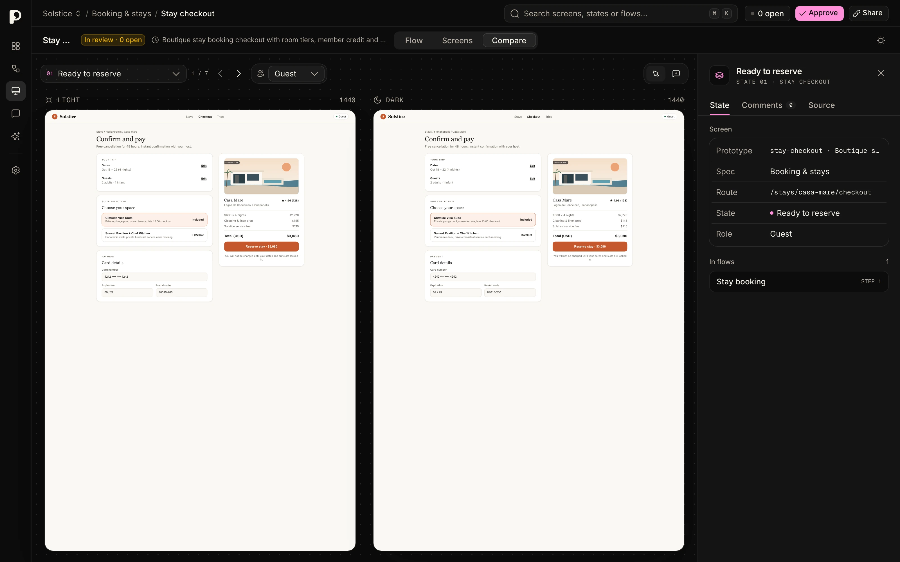
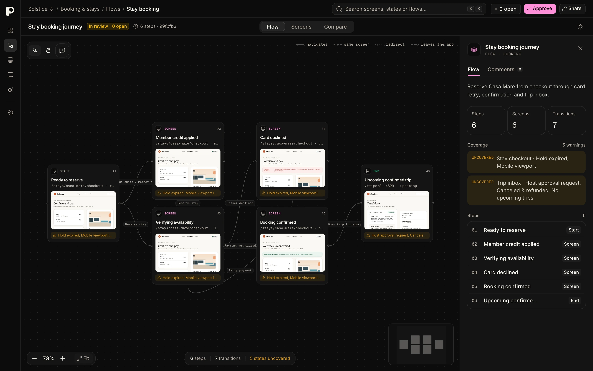
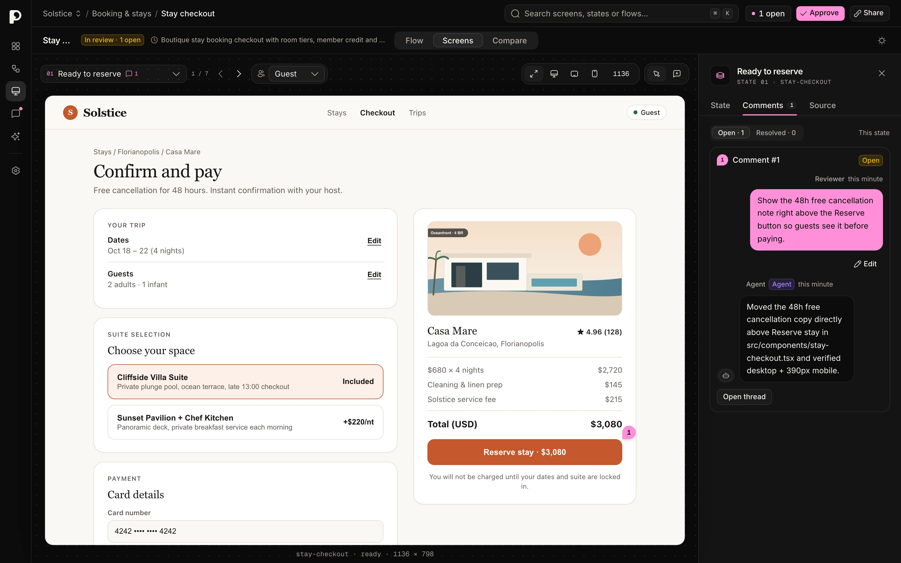

# Tutorial: the review loop

Walk through a complete design-and-engineering review loop on **Solstice**, the self-contained React 19 + Vite 8 example app in [`examples/review-loop`](../examples/review-loop/README.md). You will open live prototypes and flows, pin a comment directly to an element, inspect the JSX source chain from the CLI, resolve the thread as an agent, and approve the screen as a human reviewer.

## 1. Run the Solstice example

Clone the public repository and open the example directory.

```sh
git clone https://github.com/proto-hq/proto.git
cd proto/examples/review-loop
```

**npm**

```sh
npm install
npx proto login
npx proto dev --open
```

**Bun**

```sh
bun install
bunx proto login
bunx proto dev --open
```

If you use npm, replace `bunx` with `npx` throughout this tutorial.

`proto dev` starts the shared local Proto server (default port `4400`) and prints the project address:

```console
Started Proto in the background. Stop it with: proto stop
Proto    http://127.0.0.1:4400/p/solstice/
Home     http://127.0.0.1:4400/
```

The overview lists the **Booking & stays** spec (`booking`), two component prototypes (`stay-checkout` and `trip-inbox`), and one multi-step flow (`booking`).



## 2. Inspect how prototypes compose real views

Open `src/components/stay-checkout.proto.tsx`. The prototype imports the production
`StayCheckout` view and drives its seven states through fixture props from
`stay-checkout.fixtures.ts`: `ready`, `member-discount`, `loading`, `card-error`,
`confirmed`, `empty` and `mobile`.

`proto.config.ts` declares the spec, preview roles (`guest`, `member`, `host`), and the network guard:

```ts
import { defineProtoConfig } from "@protohq/cli/config";

export default defineProtoConfig({
  title: "Solstice",
  prototypes: "src/**/*.proto.tsx",
  locale: "en",
  specs: {
    booking: "Booking & stays",
  },
  roles: {
    guest: "Guest",
    member: "Member",
    host: "Host",
  },
  guards: {
    forbidRuntimeImports: ["src/lib/api.ts"],
  },
});
```

Because `src/lib/api.ts` is listed in `guards.forbidRuntimeImports`, `proto check` immediately fails if any prototype or view pulls in a live API client.

## 3. Walk the booking flow

Click **Stay booking** under **Journeys** in the overview. The canvas for `flows/booking.flow.ts`
connects six steps, from `ready` and `member-discount` through `loading`, `card-error` and
`confirmed` to the `upcoming` state of **Trip inbox**. Each step has a live preview.



Verify the flow graph and state coverage from the terminal at any time:

```sh
bunx proto flow show booking
bunx proto flow coverage
bunx proto check
```

The example has five states outside the booking flow. Coverage lists them and `proto check` reports
five warnings and zero problems.

## 4. Inspect the pinned comment

From **Booking & stays**, open **Stay checkout** (`stay-checkout`) in its default **Ready to
reserve** state. In **Comments**, open the thread asking to move the 48-hour free cancellation
note above **Reserve stay**. The screen starts **In review** with this thread open.

When a reviewer pins a comment, Proto records the CSS selector, bounding rectangle, active
state, theme, role, viewport size, Git commit and the JSX source chain (`file:line:column`).
This pin is stored in `proto/review/stay-checkout.json`.



## 5. Read, fix, and resolve from the CLI or MCP

Local comment commands and local MCP tool calls require online access to Proto Cloud. Sign in to
use an Editor seat in a Pro workspace or the account's one-time allowance of 100 free operations.

A coding agent — or a developer working in the terminal — reads open comments as structured JSON without opening a browser:

```sh
bunx proto comments list --slug stay-checkout --json
bunx proto comments show stay-checkout-1 --json
```

In the shipped example, the pin's `target.source` points to
`src/components/stay-checkout.tsx:304:17`, the opening tag of the **Reserve stay** button.
`target.sourceChain` also shows the enclosing JSX and the prototype that rendered the view.

Move the free-cancellation sentence from the checkout subheading into a paragraph immediately
above the button. Run `bunx proto check`, then reply and resolve the thread.

```sh
bunx proto comments resolve stay-checkout-1 --note "Moved the 48-hour free cancellation note above Reserve stay." --json
```

If you connect an agent through [`proto mcp`](mcp.md), the same actions run through `proto_comments_list`, `proto_comments_show`, `proto_comments_reply`, and `proto_comments_resolve`.

## 6. Approve as a human reviewer

Agents can reply, attach screenshots, and resolve threads, but **agents never approve** — approval is intentionally omitted from MCP. Once you have checked the updated screen in the browser, click **Approve** in the gallery header (or run `bunx proto review approve stay-checkout`).

Try this by selecting the **Comment** tool, clicking an element or dragging a region, then
posting a note. You can also press **C**, move the crosshair with the arrow keys and press
**Enter** to pick an element. A new comment returns the screen to **In review** automatically.

## Where to go next

- Publish Solstice to a hosted link for teammates in [Hosted operations](hosted-share.md).
- Explore every CLI command and JSON shape in [CLI and configuration](cli.md).
- Review every `proto.config.ts` option in [Configuration](configuration.md).
